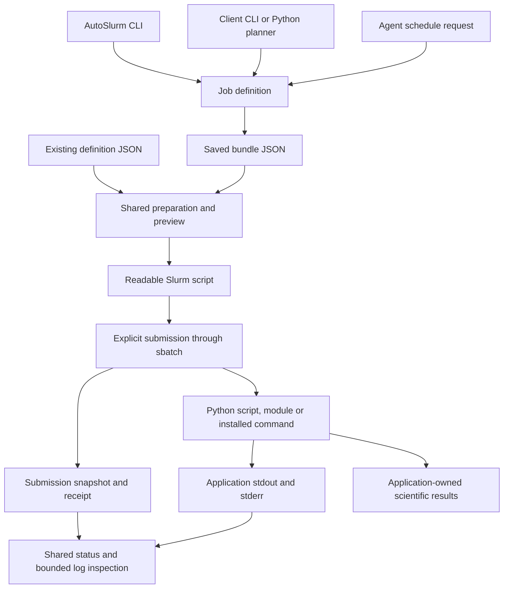

# AutoSlurm interaction map

## Purpose and status

**Draft for review, 2026-11-09.** This map describes the target interactions that
the refactor must support. It specifies user outcomes before choosing modules,
command names, or storage implementations. Entries are requirements, not claims
that the current package implements them. The [MVP plan](../PLAN.md) selects a
small subset for each usable release; review that subset before its changes,
rather than finalizing every future contract before implementation.

MVP2 preserves known/partial submission outcomes and stops on uncertainty.
Automatic reconciliation/resume in I07, automated retries in I14, complete
offline indexing and published documentation remain later work. The map is
full-product coverage, not the acceptance checklist for every early release.

The [job-script interaction map](#job-script-interactions-current-code-and-design-review)
below is a current-code audit dated 2026-11-13, followed by explicitly proposed
design principles. The other interaction contracts remain full-product targets.

The primary journey starts with an agent developing scientific software on the
workstation. That agent adapts the application to AutoSlurm, defines work, submits
it through the login node, and later returns to discover what ran and what needs
attention. A person can perform the same operational interactions in a terminal.
The human guide explains the package's purpose and system map, then illustrates
these journeys with examples; the agent guide supplies detailed integration and
operation contracts. See [the documentation and distribution design](documentation-and-distribution-design.md).

## Participants and ownership

| Participant | Owns |
|---|---|
| Client application and its development agent | Scientific computation, input validation, task partitioning, resource needs, result meaning, checkpoints, application logs |
| AutoSlurm | Validated work definitions, run/attempt identity, Slurm submission and dependency translation, durable tracking, observations, artifact locations, operational diagnostics |
| Operator | Machine configuration, credentials, explicit package preparation, resource/account constraints, scientific retry policy |
| Login node and remote helper | Bounded remote checks, scheduler commands, transfers, submission receipts; no agent reasoning process is required there |
| Slurm and compute nodes | Scheduling and execution of prepared commands; compute jobs require no internet for AutoSlurm operations |

AutoSlurm reports scheduler success and artifact availability separately. The
application defines whether a result is scientifically valid. An SSH failure is
not evidence that a computation failed; a log file is not evidence of success.

Application paths are relative. AutoSlurm owns machine-root discovery and uses
one [path contract](target-architecture.md#application-path-contract) for preview,
execution and artifact lookup. Each application run/bundle targets one machine;
multi-machine orchestration is outside scope.

## Interaction sequence

| Stage | Interaction IDs | Outcome |
|---|---|---|
| Install and orient | I00 | A usable package, human overview, and installed agent guidance are available outside the repository |
| Discover and integrate | I01-I03 | The agent knows the supported interface, the application is runnable, and the cluster is ready |
| Define and submit | I04-I07 | Work is validated and every accepted or uncertain submission is accounted for |
| Return and understand | I08-I11 | A fresh session can find runs, refresh observations, inspect tasks, and diagnose failures |
| Retrieve and recover | I12-I14 | Applications retrieve results; cancellation is observed and retries retain history |
| Retain and hand off | I15-I16 | Cleanup preserves tracking and another session can continue from durable records |

The sequence can branch. I07 handles a lost submission response before any
retry; I11 diagnoses before I14; I08 and I16 allow a session to resume anywhere.
Monitoring and result retrieval can continue while other array tasks run.

## Job-script interactions: current code and design review

**Audit, 2026-11-13, dev source 297de16.** Requested in DOCS.2 to understand the
whole job interface before choosing another argument style. This section maps
current behavior; recommendations below are proposals, not approved interfaces.
No job/script execution, runtime format or lasting preference changes here.

### Working distinction

There are two different Python scripts to consider: the workstation program
that defines/submits work, and the scientific program that executes on a compute
node. Embedding AutoSlurm in the first does not require importing it in the
second. There are also two CLIs: AutoSlurm's authoring/operating CLI and the
application's scientific CLI. JSON stores a definition or observation; it is not
currently the scientific program's execution protocol.

### Authoring and operation routes today

| Route | What the user/client supplies | Current translation | What ultimately runs |
|---|---|---|---|
| Ordinary application CLI, without AutoSlurm | `python analysis.py --seed 17`, `python -m package.task --seed 17`, or `science-tool fit --seed 17` | Application's own parser calls scientific code | The application, without AutoSlurm records or scheduling |
| Ordinary Python scientific call, without AutoSlurm | Import a function and call it in the current process | Python binds its arguments normally | Local computation; passing that function to AutoSlurm for remote execution is not a current feature |
| Handwritten Slurm script, without AutoSlurm | A shell script with SBATCH settings and an application command | User runs sbatch directly | Same ordinary command under Slurm; AutoSlurm does not import/adopt that existing script or its jobs automatically |
| AutoSlurm terminal authoring | `asl schedule COMMAND` plus scheduler/application options | Schedule CLI executes local COMMAND --help, heuristically parses options, constructs a job mapping, calls schedule_job and saves JSON; --submit separately proceeds to submission | Rendered ordinary application command in a Slurm script |
| Client's Python planner | Dictionaries passed to schedule_job or save_bundle, followed by preview_bundle and submit_jobs with an exact path | Public APIs save/load definitions and share preparation/dispatch | Same rendered command; the workstation Python call is not serialized for remote execution |
| Client's own CLI | A command such as an application's plan/submit command | Client validates scientific settings, builds job mappings and calls the same Python APIs | Same command; this is an application-specific authoring interface, not another compute execution backend |
| Existing readable JSON bundle | An exact definition path supplied to preview_bundle/submit_jobs or asl submit --bundle-file | JSON load, dependency graph and the same preparation/dispatch | Same command; JSON is consumed by AutoSlurm, not automatically passed to the scientific program |
| Agent ACP request | A JSON request with action=schedule, bundle and job | execute_acp delegates to schedule_job; inspection actions delegate to shared evidence operations | Same saved definition path; ACP currently exposes no submit action, so submission uses the authorized Python/CLI surface |

ACP request JSON, saved definition JSON, submission snapshot JSON and receipt
JSON serve different purposes. Do not treat an arbitrary tool request or receipt
as the job's application configuration. New definitions should use public save
operations; retain exact references rather than editing historical evidence.

Only execution logs from the application flow into AutoSlurm inspection;
scientific results and their validation remain application-owned. Preview
prepares the same invocation without saving submission scripts or dispatching;
configured machine/path checks may contact the target. It is not necessarily an
offline operation. The diagram does not imply that viewing a preview submits it.
Submission prepares again from the exact saved definition through the same
pipeline; an earlier preview does not freeze paths, software or machine state.

### The shared lifecycle and evidence

| Stage | Current owner | Information and limits |
|---|---|---|
| Author and save | schedule CLI, client, ACP; save_load_jobs | Command, script_args, declared paths/cwd, environment, resources, dependencies. Saving performs basic structure/default handling, not full arbitrary-CLI signature validation |
| Select and prepare | job_runner, bundle_preparation, execution | Load an exact bundle, validate structural/graph/path rules, bind one machine, retain logical/resolved paths, render scripts, check required paths and shell syntax |
| Compile application invocation | job_to_slurm | Emit environment activation/exports, cwd and an ordinary command. The renderer currently combines CLI argument conventions with shell formatting |
| Record and dispatch | submission_operation, bulk_submit_driver | Create a producing snapshot/receipt, stage exact scripts, submit jobs with scheduler dependencies, persist accepted IDs and uncertain/rejected outcomes |
| Execute | Prepared environment, Slurm, application CLI | Application receives process arguments, environment, cwd and Slurm array variables; no automatic application import/call through AutoSlurm, no job-time Git/install |
| Observe and resume | submission, inspection, scheduler, log_files | Submission receipts, task states/reasons/exit codes and bounded recorded logs, with timestamps/errors/freshness; no automatic scientific result validation |

Definition JSON records requested settings. The submission snapshot also carries
producing machine/resolved execution evidence; receipt JSON describes submission
outcomes. Generated scripts show the executable invocation and logs show runtime
observations. These are related evidence, not interchangeable records. A saved
commit/path does not freeze mutable source or environments until the job starts.

### Current differences and brittle boundaries

1. CLI authoring and Python authoring do not validate equally. The schedule CLI
   uses regexes over --help and generally stores argument text; it does not derive
   a complete typed signature. Repeated options overwrite one mapping key. A
   Python client retains native types, but bypasses this discovery entirely.
   Scheduler and application option namespaces also need a deliberate boundary.
2. Bare .py handling differs. schedule_job prefixes a single .py script with
   python, and save_bundle's append route uses that normalization. A plain
   save_bundle does not apply it. CLI help inspection of an existing local file
   uses the workstation's interpreter. None of this stages source files or
   discovers a script under software_root on the target. Explicit target-valid
   commands avoid relying on these differences. The CLI help probe accepts a
   local file or one executable name, not a general program/subcommand argument
   vector; a multiword script string accepted by a Python-built job does not
   automatically have an equivalent terminal discovery path.
3. The command is currently free-form script text. Scalar/list/boolean expansion
   and quoting happen inside the renderer. There is no shared, recorded argument
   token contract. Lists use one flag and several words; False/None/empty lists
   are omitted; ordinary strings/list elements are unquoted. The requested
   list_style/bool_style fields are not implemented.
4. Shell syntax validity does not establish CLI validity or preserve intent.
   Omitted, explicitly false and explicitly empty can select different defaults.
   A command's list conventions and positive/negative flag names cannot reliably
   be inferred from a Python value or one job-wide style setting.
5. The current application entry points need no AutoSlurm dependency. Requiring
   them to read AutoSlurm bundle files or execute serialized Python callables
   would add a different runtime contract, not merely improve authoring.

### Proposed working principle and alternatives

**Proposed:** one readable serializable job definition is the shared authoring
contract; ordinary commands remain the default execution boundary. CLI, Python
and agent tools construct that same definition. JSON preserves it. AutoSlurm
validates/resolves it and produces a readable Slurm script. The scientific
application remains independently runnable without AutoSlurm.

This keeps the familiar Python-script/registered-command workflow and permits a
simpler Python builder for applications without turning Python authoring into
remote callable serialization. Typer can remain preferred client tooling while
AutoSlurm's core accepts command contracts independent of a particular parser.
The exact builder/contract shape has not been selected or implemented.

| Alternative | Benefit | Consequence for this user/workflow |
|---|---|---|
| Ordinary script/module/installed command plus explicit named arguments | Runs manually and under Slurm; rendered invocation remains inspectable | Needs reliable common argument compilation and command-specific validation |
| Python helper builds the same command-based definition | Less repeated client glue; native values stay readable in JSON | Useful authoring convenience; can reuse the existing execution/receipt engine |
| Application receives a job JSON file and reads its settings | Can represent complex structured inputs directly | Couples application to a job-file schema and hides settings from the shell invocation; conflicts with the currently accepted no-hidden-config preference |
| Python function/decorator scheduled as a remote task | Natural Python authoring and potential signature metadata | Requires explicit importability, argument binding and a runtime launcher/version contract; arbitrary closures/object serialization would be additional scope |

A future small argument refactor could separate named values, command-option
semantics and shell emission: definition -> validated argument tokens -> rendered
script. Command semantics can describe option names, value types, repeated/tuple
forms and explicit boolean flags. Start with needed cases and reuse preparation;
this map does not propose a universal CLI framework, new storage model, arbitrary
shell interpreter, remote agent or environment/release manager.

### Decisions to review before implementation

DOCS.3 investigates a concrete [readable command/job pattern](design/job_command_pattern.md)
with a client walkthrough, human review expectations, a local experiment and
small proposed slices. Its adapter/API sketches remain unimplemented proposals.

- Keep ordinary command execution as the common boundary, with Python helpers
  improving definition authoring? Or deliberately introduce another runtime mode?
- What is the smallest shared command/argument contract that serves terminal,
  Python and agent clients without guessing from help text?
- Which argument forms need first-class support, and where does command-specific
  validation live? Any policy change allowing lists/spaces/default-on flags needs
  explicit agreement; DOCS.1's scalar/CSV/default-off/safe-word rules still apply.
- How can preview, submission and local smoke invocation use the same compiled
  arguments, with requested/resolved/actual evidence kept distinguishable?

**Evidence and completion:** read the current implementations in
[schedule CLI](../src/autoslurm/apps/schedule.py),
[bundle persistence](../src/autoslurm/save_load_jobs.py),
[preparation](../src/autoslurm/bundle_preparation.py),
[execution/path binding](../src/autoslurm/execution.py),
[rendering](../src/autoslurm/job_to_slurm.py),
[submission coordination](../src/autoslurm/submission_operation.py),
[driver](../src/autoslurm/bulk_submit_driver.py),
[ACP](../src/autoslurm/acp.py) and [inspection](../src/autoslurm/inspection.py).
Reviewed current source/entry-point routes and documentation links/diagram.
Documentation-only mapping; no new execution mode, argument flags, enforcement,
saved data migration, cluster command or application test was performed.

## Interaction contracts

Every public interaction has explicit inputs, an outcome, durable evidence,
failure/uncertainty behavior, and a next step. Read operations say whether they
are cached or perform remote work. Stable identifiers survive agent sessions;
display row numbers and a moving `latest` selector are convenience inputs only.

### I00 Install and understand the package

- **Intent:** a human or agent installs AutoSlurm and understands what it does,
  where it runs, what it owns, and which prerequisites remain outside it.
- **Inputs:** supported Python environment, released package/version, target
  workstation or login-node role, and an existing or new runtime storage root.
- **Outcome:** working entry points, version-matched installed agent resources,
  and a human guide explaining the system and first-run workflow. Distinguish
  installing AutoSlurm from preparing a scientific application or cluster account.
- **Evidence:** version and compatibility report, local help/resource checks,
  documented runtime locations, and migration outcome when upgrading.
- **Failure and next step:** unsupported Python, missing optional tools, missing
  package resources, or incompatible helper versions have actionable messages.
  No source checkout, writable installation directory, or compute-node internet
  is required for normal operation. Continue to I01/I03.

### I01 Discover capabilities and load task context

- **Intent:** an agent with no previous chat context determines how to integrate
  or operate the installed AutoSlurm version.
- **Inputs:** installed version, target task, optional client application.
- **Outcome:** a short entry guide, relevant recipe, supported public operations,
  input/output contracts, and implemented versus unavailable capabilities.
- **Evidence:** versioned documentation/capability identity carried into later
  requests; incompatible local and remote helpers are visible.
- **Failure and next step:** unsupported operations are explicit. The agent
  loads the integration recipe for I02 or resumes an existing run through I08.
  It does not infer available features from an aspirational design document.

### I02 Adapt client software for AutoSlurm

- **Intent:** make an existing or new application runnable locally and on the
  cluster through the same installed entry point and validated configuration.
- **Inputs:** package, command interface, data/output contract, workload shape,
  resource requirements, and local validation example.
- **Outcome:** a small application integration with declared relative paths and
  their bases, per-task
  work, environment needs, errors, and result declarations. Submission logic
  calls AutoSlurm's supported interface instead of copying SSH/Slurm plumbing.
- **Evidence:** client integration manifest or equivalent recorded configuration,
  a local smoke example, and a bundle-building example with expected outputs.
  The exact manifest format is a design choice, not a new required file yet.
- **Failure and next step:** distinguish incomplete application integration from
  cluster unavailability. Validate the command locally before I03-I05.

### I03 Check machine and application readiness

- **Intent:** determine whether the selected machine can run the application.
- **Inputs:** named machine, entry point, expected revision/environment, required
  storage locations, resources, and scheduler account.
- **Outcome:** check SSH/helper compatibility, command availability, environment,
  machine roots/path mappings, and requested-versus-observed code identity through
  the login node. Report unresolved roots before submission, without requiring
  application-side hostname checks.
- **Evidence:** a timestamped readiness report listing checks performed,
  observed versions, mismatches, unknowns, and checks still needed at startup.
- **Failure and next step:** explain configuration, authentication, installation,
  or revision problems separately. Package updates are explicit operator work,
  followed by a new check. Checks do not mutate a shared installation or prove
  it cannot change while a job waits in the queue.

### I04 Define a workload and its dependencies

- **Intent:** describe one job, a sweep, an array, or a map/reduce graph.
- **Inputs:** commands and arguments, input references, resources, environment,
  dependency conditions, task partitioning, expected outputs, and code identity.
- **Path rule:** application input/output/working paths are relative to declared
  bases. The definition remains portable; a run binds it to one selected machine.
- **Outcome:** a saved, identifiable definition with explicit task/output
  ownership. Separate creating a definition from launching it.
- **Evidence:** the definition and its revision/identity, including parameters
  and scientific input identifiers supplied by the client.
- **Failure and next step:** report invalid or missing fields at their location;
  never silently reinterpret unknown arguments or resource requests. Proceed to
  I05; editing work does not rewrite the history of an earlier submission.

### I05 Validate and preview the execution plan

- **Intent:** inspect what will run before scheduler side effects.
- **Inputs:** exact saved definition and target machine.
- **Outcome:** validate the graph and application contract, resolve paths and
  environment for that machine, and show commands, working directory, arrays,
  dependency conditions, and original/resolved artifact paths. Use the same
  resolver as execution and retrieval.
- **Evidence:** the plan tied to the exact definition and readiness observations;
  distinguish local-only validation from checks that contacted the cluster.
- **Failure and next step:** identify blockers and warnings without submitting.
  Do not reserve IDs or imply scheduler acceptance. Valid work proceeds to I06.

### I06 Submit and preserve the outcome

- **Intent:** launch the validated definition once as a tracked attempt.
- **Inputs:** exact definition/plan identity, machine, and an operation identity
  that can be reused to reconcile a repeated request.
- **Outcome:** record accepted jobs, rejected jobs, blocked dependents, and
  unknown outcomes separately; apply dependencies before dependent submission.
- **Evidence:** run/attempt identity, machine-scoped Slurm IDs, plan identity,
  timestamps, incremental remote receipts, and execution provenance where known.
- **Failure and next step:** a later failure preserves earlier accepted IDs.
  Record scheduler effects before acknowledging success where possible. Lost
  responses go to I07; a blanket legacy fallback cannot repeat the submission.

### I07 Reconcile an interrupted or repeated submission

- **Intent:** recover after transport loss, a client/helper crash, or an agent
  repeating a request without remembering its previous outcome.
- **Inputs:** recorded run/attempt and operation identity, durable receipts, and
  optional scheduler evidence.
- **Outcome:** recover known accepted jobs and classify unresolved ones. Resume
  only work proven safe to submit under the agreed recovery contract.
- **Evidence:** reconciliation observations and actions appended to the attempt;
  preserve both the original failure and the recovered scheduler identity.
- **Failure and next step:** ambiguity remains explicit. Do not promise
  exactly-once submission when acceptance is unobservable. Return the specific
  unresolved items and evidence needed before retrying, rather than guessing.

### I08 Rediscover work after losing session context

- **Intent:** a returning agent asks what it submitted, what remains active,
  which tasks failed, and which results are ready.
- **Inputs:** optional project, machine, definition, run, time, or status filters.
- **Outcome:** list stable run identities and summaries, including submission
  uncertainty, task counts, observation age, and outstanding actions.
- **Evidence:** lookup reads durable records and returns references usable by
  I09-I14. The client can store returned run identities in its own experiment
  record without reading AutoSlurm's private storage layout.
- **Failure and next step:** distinguish no matching local record from an
  unavailable/corrupt index or unsynced remote receipts. Unknown remote jobs are
  not automatically adopted as client runs. Select an exact run to continue.

### I09 Refresh scheduler observations and local artifacts

- **Intent:** get fresh state without losing the last useful local snapshot.
- **Inputs:** exact run or machine scope, requested observation/artifact scope,
  and optional result filters.
- **Outcome:** batch scheduler queries, update task mappings, and transfer
  selected files, including growth in existing logs.
- **Evidence:** per-source observation times, refresh success/failure, local
  availability, and last successful values. Partial refresh is not all-or-nothing
  success, and read-time does not replace observation time.
- **Failure and next step:** retain prior values with freshness warnings. A
  missing queue entry is not success; delayed or unavailable accounting remains
  unknown. Cached I10 remains usable without another network request.

### I10 Inspect one run or array task

- **Intent:** answer what ran, where, with which code, what its state is, and
  where its logs/results are.
- **Inputs:** stable run/job/task selector, cached or explicit refresh mode,
  requested detail and log limits.
- **Outcome:** consistent summary and task detail from one resolved model;
  show failed, active, completed, and unknown task counts separately.
- **Evidence:** task index, array parent and logical/raw Slurm identities,
  observation time/source, submitted command, code identity, and artifact refs.
- **Failure and next step:** an absent mapping/log is distinct from no output
  yet. Return bounded excerpts and a continuation/reference for larger logs.
  Failures lead to I11; available outputs lead to I12.

### I11 Diagnose a failure with evidence

- **Intent:** determine which tasks failed, why, and what action is justified.
- **Inputs:** run/attempt/task identity and available scheduler, helper,
  application, and artifact evidence.
- **Outcome:** separate submission/transport failures, scheduler rejection,
  pending dependency/resource reasons, cancellation, resource termination,
  application nonzero exit, missing expected results, and unknown causes.
- **Evidence:** exit code/signal/reason when available, source and time, bounded
  stderr/log excerpts, and links to the exact attempt and artifacts. A suggested
  cause is labelled as an inference; absence of evidence stays unknown.
- **Failure and next step:** distinguish failed computation from failed
  observation. Suggest a supported action and its preconditions; do not retry
  or alter resources automatically just because a log contains an error word.

### I12 Retrieve and check declared results (application-owned)

The user's MVP8 scope clarification leaves scientific transfer and validation in
client software. AutoSlurm retrieves execution evidence through I10/I11 only.

- **Intent:** the application brings useful scientific outputs back without
  asking AutoSlurm to scan/copy its output directories.
- **Inputs:** application-owned result locations, transfer policy and validation.
- **Outcome/evidence:** the application records transfer/validation outcomes and
  retains AutoSlurm's exact run/task identity and producing paths for provenance.
- **Failure and next step:** interrupted transfer or scheduler completion alone
  does not establish valid results. Application transfer retries never imply a
  new compute submission. No generic result downloader is planned in AutoSlurm.

### I13 Cancel selected work

- **Intent:** stop a run or selected array tasks and explain downstream impact.
- **Inputs:** stable selection, latest known state, and cancellation scope.
- **Outcome:** preview affected jobs/dependents, issue cancellation, and later
  distinguish the accepted request from observed terminal cancellation.
- **Evidence:** request outcome per scheduler ID and subsequent observations;
  preserve attempts, logs, and any completed results.
- **Failure and next step:** races with completion or stale state are explicit.
  A transport failure does not mean cancellation succeeded. Reconcile/refresh
  before deciding whether another cancellation request is necessary.

### I14 Retry failed work and repair downstream execution

- **Intent:** rerun selected failed shards or a corrected job without losing
  successful work or overwriting its explanation.
- **Inputs:** original run/attempt/task IDs, failure diagnosis, selected tasks,
  changed parameters/code/resources if any, and output reuse policy.
- **Outcome:** create a linked new attempt; show how original successes and
  retried tasks satisfy downstream dependencies. Define whether an existing
  reduce job is replaced, repaired, or left blocked before submitting it.
- **Evidence:** retry lineage, selected task indices, changes from the previous
  attempt, output ownership, and the revised downstream plan.
- **Failure and next step:** unresolved acceptance goes to I07. A retry with new
  code is a recorded change, not an invisible continuation. Checkpoint/resume
  semantics are provided by the client, not guessed by AutoSlurm.

### I15 Retain history and clean selected artifacts

- **Intent:** reduce clutter while keeping the ability to explain prior runs.
- **Inputs:** retention policy, stable selection, artifact categories, preview.
- **Outcome:** separate hiding/archiving a run from deleting its files; show
  retained metadata and links that will no longer resolve after deletion.
- **Evidence:** cleanup record and surviving lineage/provenance. Live or unknown
  work is protected unless an explicit reviewed policy permits the operation.
- **Failure and next step:** report partial deletion per item. Lost observation
  access cannot establish that files are safe to remove.

### I16 Hand off to a new agent or terminal session

- **Intent:** continue an investigation or workflow without relying on chat
  memory, a copied filesystem path, or the exact row order of a previous table.
- **Inputs:** run/project scope and requested context budget.
- **Outcome:** compact snapshot with intent, code identity, attempt lineage,
  task states, unresolved submissions, failures/evidence, artifact references,
  observation times, and supported next operations.
- **Evidence:** stable references plus capability/schema identity; the snapshot
  points to detailed records and logs instead of embedding every file.
- **Failure and next step:** show omitted, unavailable, or stale information.
  Another session can start at I01/I08 and arrive at the same underlying records.

## Client software practices that must be taught

The agent documentation must explain these choices while the client is being
built, before it schedules its first expensive experiment.

| Topic | Client practice | AutoSlurm contract |
|---|---|---|
| Application boundary | Separate scientific functions from CLI and bundle-building glue; keep imports free of submission side effects | Accept a supported command/specification without importing the client's internal workflow |
| Installed commands | Provide a discoverable entry point, explicit argument/config validation, and a cheap local smoke workload | Validate command availability and report unsupported inputs; no workstation-specific source paths |
| Portability | Declare relative input/output/working paths and their bases; no absolute filesystem prefixes or hostname-dependent client code | Discover/validate selected-machine roots; use one resolver for preview, execution and retrieval; retain logical and resolved paths per attempt |
| Arrays | Derive a shard from task index, total tasks, and seed/input identity; define uneven partitions and zero-based/one-based indexing | Preserve original task indices and map them consistently to scheduler/log identities |
| Output ownership | Give each task a unique destination; publish completion only after its outputs are ready; reducers check expected inputs | Track producer attempt and declared artifacts; distinguish partial output from complete result |
| Resources | Expose worker/thread limits; match them to allocated CPUs/GPUs; record measured resource needs | Pass explicit resources/environment without universal workload-size guesses |
| Failure reporting | Return nonzero on failure, preserve useful stderr and exception context, avoid swallowing exceptions | Capture scheduler outcome and link available application evidence to the exact task |
| Scientific metadata | Record parameters, random seeds, input identity, application revision, and result schema | Link client-supplied metadata to the immutable definition and each attempt |
| Resume and retry | Declare whether rerunning is safe, how checkpoints are recognized, and when outputs may be reused | Preserve lineage and validate a retry plan instead of assuming idempotent computation |
| Environment | Use an explicitly prepared cluster installation; distinguish requested and observed versions | Check/report mismatches and unknowns; never install or pull code inside a compute job |
| Results | Provide a small manifest/summary and explicit merged/figure locations where useful | Expose producing run/path evidence and bounded execution logs; scientific result transfer and validation remain with the client |
| Experiment records | Save returned stable run/attempt references in the client experiment record | Support rediscovery without reading private bundle/index files or editing Slurm scripts |

## Reliability traces for design and validation

| Trace | Required observable result |
|---|---|
| T01 New application | I01-I06 produce a locally validated client, a reviewed plan, and a tracked run using a prepared cluster environment |
| T02 Acceptance then SSH loss | I06-I07 recover receipts or expose unresolved acceptance; no automatic duplicate submission |
| T03 Partial dependency graph | Accepted roots remain tracked; failed roots and blocked dependents are distinguishable; later reconciliation preserves the graph |
| T04 Mixed array outcomes | I09-I11 agree on failed/completed/unknown tasks and their logs; I14 retries only the selected indices and replans reduce |
| T05 Offline return | I08/I10/I16 work from durable local records with observation age and explicit limits |
| T06 Accounting unavailable | Refresh failure preserves older observations; no empty query is promoted to successful completion |
| T07 Scheduler success but missing output | I10 reports scheduler completion; I12 separately reports missing/incomplete artifacts and client validation failure |
| T08 Code mismatch or mutation | I03 reports mismatch; any submission/startup observations are preserved without claiming version checks froze the installation |
| T09 Cancellation race | I13 records request and observed outcome separately, including completion before cancellation |
| T10 Large logs and resumed agent | I11/I16 return bounded evidence and stable references sufficient for a new session to continue |
| T11 Clean installation | Wheel/source installs outside the checkout provide commands, writable runtime storage, installed context and a usable human first-run guide |
| T12 History retention | Cleanup protects live/unknown work, reports partial actions, and preserves the agreed lineage after selected artifacts are deleted |
| T13 Relative path portability | The same relative workload resolves consistently for two profiles in separate single-machine runs; unrelated current directories do not affect resolution, missing roots are errors, and old artifacts retain their recorded locations after profile changes |

## Current interface gaps to resolve

The existing ACP dispatch implements scheduling, listing experiments, textual
inspection, and documentation gathering. It does not establish a structured
end-to-end contract for submission, uncertainty, failure diagnosis, or retries.
Existing CLI commands cover more operations, but agent guidance must distinguish
that coverage from ACP capabilities.

The current `agent/` material includes installation/configuration assumptions
that differ from the code and sometimes directs clients to internal helpers.
Use the initial audit in the agent documentation design and correct the relevant
claims with each MVP's small public recipe.
Keep target designs here until their operations exist; do not advertise future
commands as installed features.

## From interactions to implementation

For each accepted interaction, identify its smallest service operation, required
records, adapter needs, documentation recipe, and behavior checks. Build only
dependencies required by those operations. Use these traces to order the slices:
client contract and definitions; submission and receipts; reconciliation and
rediscovery; refresh and evidence; recovery and result retrieval.

No module tree, class hierarchy, or protocol name is accepted by this map.
Each MVP's changes must show which bounded interactions they serve.

### Planned status and reusable workflow coverage (PLAN.3)

[MVP11](design/MVP11_status_explanations.md) targets I09–I11 with readable waiting
reasons alongside unchanged scheduler evidence. [MVP12](design/MVP12_reusable_workflows.md)
targets I02–I06 resource/offline/review workflows, I08/I16 named-run handoff and
I14 explicit retry planning, with an optional scheduler-free task runtime.
These are planned capabilities, not additional installed actions. Every delivered
slice includes its public operation, evidence/failure contract, discoverable agent
recipe, human example and behavior checks. Scientific-result transfer stays
application-owned unless the separate fetch scope decision changes that boundary.
